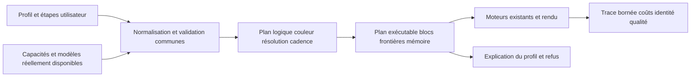

# Audit global — 17 octobre 2026

Suivi : [AH-334](https://tatoub.atlassian.net/browse/AH-334). Périmètre : les **333 tickets AH-1 à AH-333**, le lecteur et les moteurs livrés dans **3.8.0.82**, le Manager livré et les branches de travail non publiées. Extension demandée pendant l’audit : tri des documents suivis/non suivis et recherche de dépendances/code morts. Les recommandations ne sont pas des correctifs déjà livrés. La refonte UX du Manager demandée ensuite est découpée sous AH-224 en AH-341/342/343 ; elle conserve la composition libre et modulaire des profils.

## Verdict

Le projet possède de bonnes bases : références Quality conservées, identités/générations des surfaces, cadence rationnelle, preuves de qualification, pins des sources et modules. Il n’a pas besoin d’une réécriture générale. Il souffre surtout de **plusieurs représentations concurrentes du même profil**, d’une installation qui ne garantit pas toujours l’identité du code exécuté, et de trop nombreux travaux ouverts en parallèle.

Le backlog va loin sur les techniques avancées ; sa faiblesse est moins le manque d’idées que leur ordre, leur découpage et leur raccordement au produit réellement livré. Ajouter des kernels ou des modèles avant de connaître le plan exécuté, sa couleur et son coût complet peut optimiser le mauvais chemin. Une même interface sur plusieurs matériels ne constitue pas une implémentation ni une qualification équivalente.

Les actions prioritaires sont donc : protéger les profils et la provenance des moteurs ; terminer le nettoyage du Manager demandé ; corriger le contrat couleur ; puis optimiser les attentes/copies et la mémoire sur une chaîne concrète. Les modèles supplémentaires restent proposés, éventuellement en préparation hors ligne : leur lenteur ne suffit pas à les supprimer du choix utilisateur.

## Base de preuve et limites

- Lecteur : `0f3f6bfb7e76ca15647d74fc5a91405d3072be69` ; backend Linux : `463a0c73b6f2e77df09f908a3fef2bf5898cb5a1` ; bundle : `5217111b754412338fe94d236d80f39dcd42b957` ; Manager : `2847c79961c0d14241234d2ef8799b399e4b6a9d`.
- Inventaire Jira complet : descriptions, statuts, hiérarchie, priorités et liens. Chaque ticket reçoit une décision, une justification, une meilleure approche et un critère de fin dans [la revue individuelle](audit-20261017/tickets.md), avec les critères complets dans le [JSON canonique](audit-20261017/tickets.json).
- Lecture croisée du code lecteur/backend/Manager/updater/packaging. Essais CPU isolés pour AppRun, préservation des profils et codecs du worker GMFSS ; aucun profil réel ni SDK utilisateur modifié. Les constats statiques sont distingués des reproductions.
- Les résultats GPU sont ceux du [lot 55](archive/2026-10-17/qualification/lot-55-rife-fusion-20261017.md). Aucun benchmark GPU supplémentaire lancé pour cet audit. Pas de prétention d’exhaustivité ligne par ligne ni de qualification du matériel absent.

La release [.82](https://github.com/Ta2b/mpv-AnimeJaNai-HDR/releases/tag/3.8.0.82) a trois workflows réussis, 15 assets publiés et deux packs Manager explicitement réutilisés depuis .81. Les manifestes, les quatre modules GPU de l’overlay Linux et les fichiers Manager Windows de référence ont été contrôlés. [Reçu](archive/2026-10-17/jira/release-20261017-3.8.0.82.json). **AH-331/AH-332 sont Done** ; cette clôture ne prouve pas un gain complet avec HDR ou avec Quality×2→Fast×2.

## Ce que contient réellement le backlog

Au snapshot : **10 epics, 231 tâches, 92 sous-tâches** ; 56 Done, 47 In Progress, 230 To Do. Parmi les In Progress, sept sont des epics : il reste 40 autres éléments simultanément ouverts. Les 63 Highest et 138 High représentent 60 % du backlog, ce qui rend les urgences peu discriminantes. Ces chiffres précèdent la clôture de AH-331/332 et la création des tickets de cet audit.

| Famille | Tickets descendants, parents inclus | Interprétation |
|---|---:|---|
| Fidélité, caches, observabilité — AH-1 | 65 | Références et prérequis de fiabilité, pas tous des gains FPS |
| Producteur, surfaces, ordonnanceur — AH-2 | 50 | Architecture d’exécution, latence, mémoire et préparation |
| NVIDIA/AMD/Intel/Apple/Vulkan — AH-3 à AH-7 | 71 | Optimisations et adaptations propres aux API/matériels |
| Interpolation et temporalité — AH-8 | 83 | Méthodes, intégrations, politiques, Manager et qualifications |
| Graphes, kernels, recherche — AH-9 | 34 | Optimisations avancées et explorations à rendement incertain |
| Qualification, Manager, livraison — AH-10 | 20 | Produit et distribution |

Les 105 éléments des familles matériels/graphes sont environ un tiers des 323 éléments hors epics. Ce comptage inclut parents et enfants : il ne compte pas 105 fonctionnalités indépendantes. Une large partie des autres travaux soutient les performances, mais **la majorité du Jira n’est pas constituée exclusivement d’optimisations moteur avancées**. L’objectif réaliste est un contrat de qualité/comportement commun et le meilleur chemin disponible par matériel, pas le même débit partout.

Le graphe comporte 88 liens « bloque » distincts : aucun cycle, aucun préalable ouvert bloquant un ticket Done, aucun parent Done ayant un enfant ouvert dans ce snapshot. En revanche, des descriptions de parents citent des états d’enfants périmés (AH-11/236, AH-28/242, AH-33/261). L’état Jira et les reçus priment sur ces résumés historiques.

Résultat de la revue : **162 conserver, 93 reformuler, 21 regrouper, 50 différer, 6 vérifier clôture et 1 retirer**. Les descriptions des 171 tickets non conservés en l’état ont été révisées dans Jira avec le contrat précisé et leur historique préservé ; statuts et priorités distantes ne sont pas modifiés en masse. Les 162 autres ne nécessitent pas une réécriture artificielle.

La décision `regrouper` propose un lot/une autorité commune, sans supprimer automatiquement les qualifications propres à chaque API. `différer` exige un préalable ou une preuve de rentabilité ; ce n’est pas abandonner un modèle lent. `vérifier clôture` demande de préciser la portée historique, sans réouvrir automatiquement un ticket Done. Le seul objectif explicitement retiré est la poursuite FRUC AH-154, remplacée par le retrait produit AH-328 ; ses preuves historiques restent utiles.

## Défauts et risques prioritaires

P1 signifie à corriger avant de nouveaux travaux spéculatifs. Aucun incident P0 supplémentaire n’est démontré par cet audit. Les détails, lignes de code et essais minimaux figurent dans les rapports [architecture/publication](audit-20261017/architecture-publication.md), [moteurs/pipeline](audit-20261017/moteurs-pipeline.md) et [Manager/VFI](audit-20261017/manager-vfi.md).

| Priorité | Constat et niveau de preuve | Conséquence / action |
|---|---|---|
| P1 | **Updater : profil écrasé si manifeste absent/illisible. Reproduit** avec les méthodes réelles, sur dossiers temporaires. | Protéger un socle de chemins utilisateur indépendamment du manifeste. **AH-335**, sous AH-226. |
| P1 | **Ancienne bibliothèque régulière préservée, nouveau manifeste installé. Reproduit** dans AppRun ; le chargement dépend ensuite du chemin utilisé. | Séparer composants gérés et overrides, afficher chemin/hash/ABI réellement chargés. **AH-330**. Ne pas attribuer toute baisse de FPS à ce seul défaut. |
| P1 | **Script Lua géré retiré de l’archive mais conservé localement. Reproduit.** | Inventaire des fichiers gérés, nettoyage prudent des seules entrées retirées. **AH-338**, lié aux retraits AH-325/328. |
| P1 | Packs réutilisés/vérifiés par version et taille ; installation directement dans l’arbre actif, temporaires partagés. **Lecture de code**, pas corruption utilisateur observée. | Identité par contenu **AH-336**, transaction/verrou/staging et pipes drainés simultanément **AH-337**. |
| P1 | RIFE accepte des surfaces 601/2020 mais convertit avec **BT.709 codé en dur**, métadonnées conservées. **Lecture de code confirmée.** | Espace de travail explicite, vraie conversion ou refus des combinaisons non gérées. **AH-275/AH-15**. L’effet visuel reste à quantifier ; 709 du lot55 reste la référence. |
| P1 | Les targets du pipeline sont à l’intérieur de `if(AJI_FRUC_ROOT AND NOT WIN32)`. **Lecture de code confirmée.** | Découpler le pipeline CUDA avant de retirer FRUC ; sinon retrait du SDK = retrait possible du pipeline RIFE/downscale/upscale/HDR. **AH-328**. |
| P1 | Création d’étages Manager forcée TensorRT/CUDA ; résolution des dépendances différente entre C#, Lua et shell. **Lecture de code confirmée.** | Petit contrat de plan résolu commun, capacités réellement consommées, import sans changement silencieux. **AH-339**, sous AH-224, relié AH-16/277. |
| P1 | Branche nettoyage : resize historique renommé Bilinear malgré référence Spline36 et ordre historique à vérifier. Déjà livré en .82 : alias inconnu transformé en Fast. **Lecture de code.** | Migrer l’algorithme et l’ordre exacts, préserver/refuser les valeurs inconnues. **AH-325/AH-321**. Ne pas publier cette migration en l’état. |
| P1 | Branche GMFSS : état d’annulation réinitialisé après la notification `IsBusy`, validation totale de sortie limitée à 60 s. **Lecture de code.** | Réparer le cycle second job/annulation ; validation cancellable avec progression et surveillance d’inactivité, pas délai global d’un épisode. **AH-313**. |
| P2 | RIFE Fast isolé peut préparer le moteur motion que `active=false` empêche d’utiliser. **Hypothèse étayée par les conditions du code**, coût non mesuré. | Déterminer l’éligibilité avant construction et journaliser la stratégie effective. À découper explicitement comme optimisation de préparation Fast, liée à **AH-329/AH-331**, sans étendre silencieusement le périmètre Quality. |
| P2 | Fences/copies par étape, publication du burst après toutes ses sorties, TrueHDR sur stream par défaut et synchronisation du contexte. **Lecture de code.** | Optimiser les événements, le recouvrement et la sortie progressive selon la trace dominante. **AH-329/AH-189/AH-50** ; conserver le chemin exact de secours. |
| P2 | Budget 512 Mio limité au pool pixels, sans moteurs/workspaces/sorties du lecteur ; TrueHDR passe par RGBA8 malgré conteneur YUV16. **Lecture de code.** | Estimer le pic vivant et distinguer les budgets (**AH-53**). Déclarer/qualifier la précision SDK (**AH-275**) ; ne pas promettre une conservation 10 bits de bout en bout. |

Pour mémoire, 17 surfaces 3840×2160 en YUV444P16 représentent déjà 846 013 440 octets, avant moteurs et scratch. C’est un calcul de géométrie, pas une mesure de consommation effective d’un profil. Augmenter aveuglément la limite ne résout pas la rétention des surfaces.

## Architecture conseillée

Conserver les moteurs et ABI actuels. Réduire les autorités concurrentes par une progression incrémentale :

L’aperçu demandé/résolu doit être distingué de la trace réellement exécutée (AH-234). Sans média, dimensions et coûts peuvent rester inconnus ou être des estimations. Le plan doit annoncer le traitement prévu : ordre, dimensions par étape, facteurs cumulés, politique et runtime effectifs, frontière HDR, raison d’une fusion/refus et enveloppe mémoire. Un petit résultat versionné consommé par Manager/lanceurs suffit au premier lot ; aucune nouvelle infrastructure générale n’est nécessaire. Les stages gardent leur catégorie et leurs paramètres propres. L’ordre HDR choisi ne doit pas être modifié implicitement pour gagner du temps.

La fusion logique regroupe les maillons compatibles ; elle n’impose pas un unique contexte physique. Le lot55 a justement rejeté des fusions Fast×2 sans bénéfice établi. Le planificateur doit pouvoir conserver une frontière profitable, avec une raison mesurable, tout en réutilisant exactement les endpoints admissibles. Un autotuner futur verrouille modèles, précision et résolution en Quality ; toute adaptation qui les change est une autre variante explicitement choisie.

La modularisation de `Program.cs` ou des grands fichiers moteurs doit suivre ces responsabilités concrètes : installation, planification, caches, fournisseurs. Un découpage cosmétique de milliers de lignes sans contrat commun déplacerait les divergences au lieu de les résoudre.

## Améliorations supplémentaires utiles

| Piste | Bénéfice visé | Rattachement et décision minimale |
|---|---|---|
| « Expliquer mon profil » avec identité des modules chargés | Diagnostiquer résolution/facteur/politique incorrects sans deviner | AH-339/330/234 : décision Manager/lanceur cohérente et preuve du chemin chargé |
| Trace locale circulaire, export explicite en un clic | Voir coûts par intervalle, attentes, mémoire et erreurs sans logs illimités | AH-19/24/255 : overhead borné, aucune collecte réseau automatique |
| Plan mémoire par durée de vie et publication progressive | Éviter allocations tardives, OOM et délai avant première sortie | AH-53/50/36 : refus précoce CPU puis un petit burst sous quota, owners/PTS exacts |
| Fusion guidée par coûts avec clé GPU/modèle/forme/politique | Réutiliser les données sans forcer des regroupements régressifs | AH-26/51/329 : référence exacte, avantage établi sur un chemin puis conservation du repli |
| Préparateur commun aux nouvelles méthodes VFI | Rendre utilisables les modèles lourds sans multiplier les workers et UI | AH-313/298/299 : progression, annulation, reprise, audio/cadence, publication de sortie sûre |
| Amélioration de Fast sur occlusions ; filtres downscale comparés | Améliorer contours/temporalité, avec coût déclaré | AH-178/321 : un cas en défaut + référence Quality ; aucune substitution par défaut sans preuve |

Les gains sans perte à privilégier sont la suppression du calcul inutile, les caches dont l’identité est complète, la réduction des synchronisations et des copies, et l’allocation selon les durées de vie. FP16/INT8, changement de modèle, mouvement partagé approximativement ou nouvel ordre HDR ne sont pas automatiquement sans perte. Une amélioration de qualité peut justifier un changement même sans gain FPS, à condition d’en préciser le coût et les cas réellement améliorés.

## Nouvelles méthodes : approfondir sans promesse trompeuse

Le critère de rentabilité doit séparer qualité obtenue, temps de préparation, VRAM, lecture en temps réel et coût d’entretien d’un port natif. Un adaptateur préparé fidèle est un livrable utile même si un port TensorRT n’est pas rentable. Le port accéléré vient après une référence locale et un opérateur dominant identifié.

- **GMFSS AH-313** : terminer le workflow déjà engagé et ses corrections, puis comparer une paire à la référence GPU acquise ; ne pas refaire sa campagne de performance.
- **DistilDRBA AH-303** : code/poids et script d’inférence publiés ; respecter ses paramètres de temporalité, détection de coupe et précision avant toute comparaison. [Dépôt officiel](https://github.com/routineLife1/DistilDRBA).
- **FrameFusion AH-306** : la séparation prédicteur/rendu multi-instant mérite une intégration fidèle, puis une mesure par paire. Le code Apache-2.0 et les poids distribués CC-BY-NC-4.0 ont des conditions distinctes à consigner dans le mécanisme d’acquisition ; 37 Mo n’est pas une preuve de vitesse. [Dépôt officiel](https://github.com/BurguerJohn/FrameFusion-Model).
- **EISAI AH-304** : préciser le pipeline effectivement accessible. Le CLI public emploie RFR/RAFT sans l’initialisation SGM des meilleurs résultats de l’article ; ne pas lui attribuer ces résultats par son nom. [Dépôt officiel](https://github.com/ShuhongChen/eisai-anime-interpolator).
- Les solutions dont code/poids/API restent indisponibles conservent un préalable d’accès explicite. Les générateurs gardent leur workflow de création/préparation et leur différence de fidélité, sans faux choix d’interpolation de lecture.

## Classement technique des lots et critère de sortie

**Ordre de travail demandé ensuite par l’utilisateur : terminer l’audit/nettoyage actuel, puis réaliser la refonte Manager AH-341/342/343 avec modularité libre.** Le classement technique ci-dessous décrit le risque et les dépendances ; il ne remplace pas cette priorité utilisateur. Les prérequis nécessaires à une migration ou installation sûre sont traités dans le lot qui les consomme.

1. **Installation/provenance** : AH-330, AH-335/336/337/338. Les sous-tâches sont autonomes ; AH-337 dépend du contrôle de contenu AH-336. Contrôles CPU isolés, release vérifiée, aucun benchmark vidéo imposé.
2. **Terminer l’interface déjà demandée** : AH-325/326/328 et AH-339. Migration exacte, quatre catégories, HDR mpv/TrueHDR unique, retrait FRUC complet après découplage. Préserver profils inconnus/personnalisés et supprimer réellement les doublons livrés.
3. **Fidélité et exécution commune** : AH-275, AH-53 puis tranche concrète AH-329/189. Couleur, budget mémoire et stratégie effective d’abord ; retenir uniquement les optimisations ayant un bénéfice démontré. AH-333 reste une exploration différée distincte.
4. **Méthodes utilisables** : finir AH-313, puis une intégration complète à la fois parmi AH-303/306/304, avec choix Manager, dépendances, sortie et qualification. Recherche native ensuite si elle répond à un besoin mesuré.
5. **Ports matériels et recherche avancée** : sous-lots terminables par API réellement disponible ; aucun Done universel après une compilation ou un prototype CUDA. Les autres plateformes gardent une qualification ouverte explicite.

Limiter les lots effectivement en cours et distinguer parents de programme/enfants exécutables. Un parent peut rester ouvert sans faire croire que tous ses enfants sont travaillés. Remplacer les listes de statuts copiées dans les descriptions par des liens vers les enfants et un périmètre restant. Ne pas fermer en masse les doublons proposés : conserver la traçabilité et les contraintes propres aux matériels.

## Documents, code mort et suite du nettoyage

Le tri documentaire et l’audit des dépendances sont détaillés dans le [relevé de nettoyage](audit-20261017/nettoyage.md), l’[inventaire documentaire](audit-20261017/document-inventory.json), le [rapport dépendances/code mort](audit-20261017/deadcode-dependencies.md) et la [carte multi-dépôts](audit-20261017/repositories.md). La carte inclut Manager, backend RTX, backend standard, fournisseurs ORT/Vulkan/AMD/Apple, forks mpv/libass et recettes de build ; elle distingue revue détaillée ciblée et simple contrat de dépendance. Elle ne revendique pas un audit exhaustif de FFmpeg ou de tous les tiers. Les fichiers générés, SDK, modèles et modifications utilisateur ne sont pas du code mort sur la seule base de leur statut non suivi. Les callbacks, modules chargés dynamiquement et assets nommés par configuration exigent une vérification de leurs consommateurs avant suppression. Le retrait FRUC reste un lot complet AH-328, pas une suppression opportuniste qui casserait le build du pipeline.

L’audit n’implémente pas les recommandations de performance. Il fournit les preuves et les critères des prochains lots, avec le nettoyage documentaire effectué et les suppressions de code suffisamment démontrées consignées séparément.

Réécriture distante vérifiée : [171 reçus et couverture](archive/2026-10-17/jira/audit-reworked-20261017.json).
